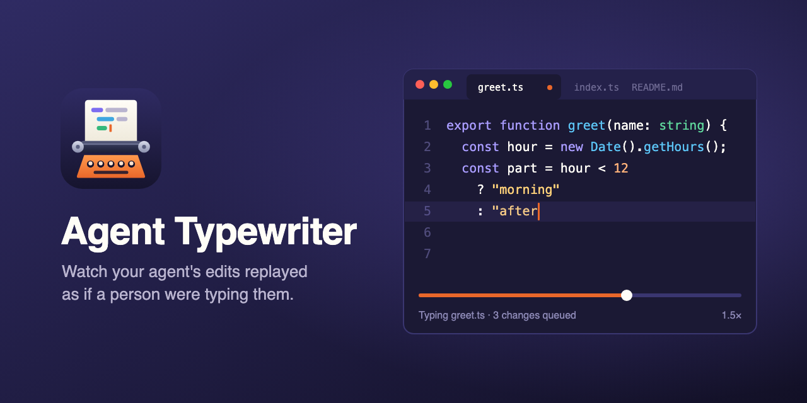

# Agent Typewriter



Watch Claude Code (or any agent, script, or teammate) write code as if a person were typing it.

Agent Typewriter ignores *how* a file was edited. It watches the workspace for changes on disk, records every change in order with its full before and after text, and replays each one into a side-by-side replay editor at human speed. When the agent touched three files, playback flips between those three tabs in the same order.

Your real files are never modified by the extension. Replay happens in mirror documents (`agent-typewriter:/src/foo.ts`) that get proper syntax highlighting from the file extension.

## Install

From the Visual Studio Code Marketplace: search for **Agent Typewriter** in the Extensions view, or run

```
code --install-extension burnzy1148.agent-typewriter
```

To install a build from a [GitHub release](https://github.com/burnzy1148/agent-typewriter/releases) or a CI artifact instead, download the `.vsix` and run `code --install-extension agent-typewriter-<version>.vsix`, or use the Extensions view, `...` menu, **Install from VSIX...**.

## Use

1. Open your project folder.
2. Run **Agent Typewriter: Start Watching** (Command Palette, the status bar item, or the **Agent Typewriter** panel in the Explorer).
3. Let Claude Code work. The replay editor opens beside your current editor and starts typing.

Set `agentTypewriter.autoStart` to `true` to start watching whenever the workspace opens.

## How it works

```
disk write ──► watcher ──► debounce ──► diff vs snapshot ──► reorder ──► timeline (ordered buffer)
                                                                               │
                                                 replay editor ◄── player ◄────┘
```

- **Snapshots.** On start, every matching file is snapshotted. When a file changes, the new text is compared with its snapshot and the event stores both sides. The before side is fixed at record time, so a sequence like A, B, A replays correctly even when playback is minutes behind.
- **Write order.** Each change is ordered by its file's modification time and held for a short reorder window (`reorderWindowMs`), so a watcher that reports writes late or out of order, as on Windows, still produces the true order.
- **Timeline buffer.** Events are kept in order (default 500, `historyLimit`). The playback cursor moves through them independently of recording, so you can replay the whole buffer or start from any event.
- **History across reloads.** The buffer and the playback position are saved to VS Code's per-workspace extension storage (not the workspace) every couple of seconds while they change, and restored when the workspace opens again. If changes were still queued, playback comes back paused so nothing starts typing on its own. Up to 64 MB of change text is kept, newest first. `persistHistory: false` turns this off and deletes the saved history.
- **Diff planning.** Changes are planned line by line, then refined word by word, so renaming one variable retypes only that token. Whole new lines are typed as lines. Leading indentation appears instantly the way an editor auto-indents. Short deletions are backspaced; longer ones are selected and then deleted.
- **Catch-up.** Agents write far faster than people type. Speed is `base x (1 + catchUpFactor x queued)` capped at `maxSpeedup`, so playback accelerates when it falls behind and relaxes when it catches up. Changes larger than `maxAnimatedChars` are applied instantly.
- **Mirror editors.** Each file gets one mirror tab, saved quietly after every change so closing a tab never prompts.

## The panels

**Explorer > Playback** controls replay like a media player:

- Replay from the start, play/pause, finish the current change instantly, skip to the next change, and skip to latest.
- Drag the slider to any recorded change and let go to seek there. Seeking keeps playback paused or playing as it was; the far end of the slider skips to latest.
- The speed picker sets a multiplier (0.5x to 5x) on top of the base speed.
- The line under the slider shows what is typing or next, and how many changes are queued.

**The replay editor** has controls too, on the tab of the file being typed (or played last):

- Its title bar has the same buttons: replay from the start, play/pause, finish current, skip to next, and skip to latest. Right-click the title bar to hide any of them.
- A row above the first line has play/pause, finish, next, latest, the speed (click to change it), and what is typing or next with the position in the buffer (click to open the Playback panel). The row is not part of the text. Set `mirrorStatusRow` to `false` to hide it, for example for screen recordings.

**Explorer > Agent Typewriter** lists recorded changes, newest first, with their state (pending, typing, played) and line counts.

- Click an entry to see its diff.
- Inline **Replay From Here** restarts playback at that change.
- Title bar: start/stop watching. The `...` menu has filters, base speed, and clear. Pause, finish current, skip to latest, and replay all are also commands in the Command Palette.

## Session files

Recorded changes are kept across reloads automatically (`persistHistory`). To take a run somewhere else, for a demo, another machine, or a reviewer, save it to a file:

- **Save Session to File...** writes every change in the buffer, with its before and after text, to a JSON file you pick. The dialog starts in your home folder. If you save into the watched workspace instead, the file itself is recorded as a change when it passes the filters.
- **Load Session from File...** replaces the buffer with a saved session (plain or gzip-compressed JSON), after asking if the buffer is not empty. Playback is paused at the first change, so resume when you are ready. If the session has more changes than `historyLimit`, you choose between raising the limit and loading the newest changes.

Both are in the panel's `...` menu. Loaded changes replay into mirror documents like any other; your real files are never written. A file saved by a newer version of the extension is refused with a message instead of being misread.

## Replaying git history

Work that was never watched, such as a branch an agent pushed overnight or a pull request, can still be typed out from git. **Replay Git Commits...** (in the panel's `...` menu) builds the buffer from a range of commits, one change per file per commit, oldest first. Pick one of:

- **This branch**: the current branch's commits that are not on the default branch (`origin/HEAD`, else `origin/main`, `origin/master`, `main` or `master`).
- **A branch...**: another local or remote-tracking branch's commits that are not on the default branch. A pull request you fetched but did not check out is replayed this way.
- **Last commit**, or **Enter a commit or range...** in git's syntax: `main..feature`, `HEAD~5..HEAD`, or a single commit.

Each change's before and after text come from the commits, not from the files on disk, so uncommitted edits do not show up. Merge commits are skipped, as `git log -p` does, and so are files the watch filters leave out, binary files, files over `maxFileSizeKB`, symbolic links and submodules. A rename replays as a delete and a create.

Like loading a session, the replay replaces the buffer (after asking) and starts paused at the first change. It also stops watching, so live edits do not mix into the history; start watching again when you are done. The repository is only read: nothing is checked out or fetched, and HEAD, the index and your files stay as they are.

## Filtering

Three settings combine. A path must pass all of them:

| Setting | Default | Meaning |
|---|---|---|
| `agentTypewriter.extensions` | `[]` (any) | Allow-list of extensions, e.g. `["ts", "java", "md"]` |
| `agentTypewriter.include` | `["**/*"]` | Workspace-relative globs. A pattern without `/` (like `*.ts`) matches the file name anywhere |
| `agentTypewriter.exclude` | `.git`, `node_modules`, `dist`, `out`, `build`, `target`, lock files, logs | Exclude always wins |
| `agentTypewriter.respectGitignore` | `false` | Also skip paths git ignores |

Shortcuts:

- **Set Watched Extensions...** prompts for a list like `ts tsx java`.
- Right-click files or folders in the Explorer: **Watch Only This** replaces the include list with your selection; **Add to Watch Filter** adds to it.
- **Reset Filters** restores the defaults.

Filter changes apply immediately while watching; newly matching files are snapshotted right away.

With `respectGitignore` on, anything git would ignore as an untracked file is skipped: `.gitignore` files at every level, `.git/info/exclude`, and your global excludes file. Files git tracks are recorded even if they match an ignore pattern, as in git. Edits to `.gitignore` apply while watching; changes to `.git/info/exclude` or the global file apply at the next start or filter change. Without git, or outside a repository, the setting does nothing and the output channel says so. With it on, the default `exclude` list is mostly redundant in a typical repository.

### Repository settings file

To share filters (or any other setting) with everyone who opens a repository, commit a `.agent-typewriter.json` at the root of the workspace folder. Keys are the setting names without the `agentTypewriter.` prefix:

```json
{
  "include": ["src/**", "docs/**"],
  "exclude": ["**/generated/**", "**/node_modules/**"],
  "extensions": ["ts", "md"],
  "charsPerMinute": 350
}
```

- Order, highest first: workspace settings, this file, user settings, defaults. So the file overrides your personal settings, and the filter commands above (which write workspace settings) still override the file locally. **Reset Filters** clears those workspace values, so the file's filters apply again.
- Edits to the file apply immediately, like a settings change. Deleting it removes its values.
- Unknown keys and values of the wrong type are ignored and listed in the **Agent Typewriter** output channel. If a save leaves the file broken JSON, its previous values stay in effect until it is fixed.
- **Open Repository Settings File** (in the panel's `...` menu) opens the file, or, if there is none, an unsaved editor prefilled with your current filters. The extension never writes the file itself; save it to create it.
- In a multi-root workspace, only the first folder's file is read.

### Filter profiles

A profile is a named set of any of `include`, `exclude`, `extensions`, and `respectGitignore`. Define them in `.agent-typewriter.json` to share them, or in the `agentTypewriter.profiles` setting:

```json
{
  "profiles": {
    "backend": { "include": ["server/**"], "extensions": ["ts"] },
    "docs": { "include": ["docs/**"], "extensions": ["md"] }
  },
  "activeProfile": "backend"
}
```

- **Switch Filter Profile...** picks a profile or "No profile". Switching clears your workspace values of the filters that profile sets, so it takes effect; other filters are left alone.
- **Save Filters as Profile...** saves the current filters under a name in workspace settings (user settings when no folder is open) and switches to it. Other saved profiles are left exactly as written.
- The active profile (`agentTypewriter.activeProfile`) overrides the repository file and user settings; workspace settings, which the filter commands write, still override it. The file can set `activeProfile` as a team default.
- Profiles with the same name merge by layer: workspace settings over the file over user settings. The panel shows the active profile's name.

### Worktrees

Agent tools often put git worktrees inside the repository, for example `.claude/worktrees/` or `.worktrees/`. A workspace folder records only its own checkout: other worktrees of the same repository inside it are skipped and get no baselines, and the panel says "other worktrees skipped". Worktrees are what `git worktree list` reports, so submodules and other nested repositories are recorded as usual. A worktree added while watching is skipped as soon as git writes its `.git` file.

To watch an agent's worktree instead, run **Choose Checkout...** or click the branch entry next to **Typewriter** in the status bar, which appears when there is another checkout to choose. It lists the folder's own checkout and every other worktree by branch (or short commit) and path, including worktrees outside the workspace folder.

A folder that holds a bare repository and its worktrees (a `.bare` directory, a `.git` file naming it, and one directory per worktree) has no checkout of its own. Until you choose one of its worktrees, even when there is only one, its worktrees are skipped like any other worktree and only files outside them are recorded: the status bar entry reads **(none chosen)** and the panel says "no checkout chosen". Choose Checkout lists the folder itself, with no checkout of its own, and each worktree.

- The filters apply within the chosen checkout, so `src/**` means that worktree's `src/`. The workspace folder's `.agent-typewriter.json` still applies.
- Changes from a chosen worktree show up under its directory name, like `feature/src/app.ts`, so the same file in two checkouts never shares a mirror. When that name is already in use, by another worktree or by a top-level file or directory of the workspace folder, the parent directory's name goes in front (`worktrees-feature`), or a number when that is taken too. A worktree keeps the name it was given while other worktrees come and go, and across reloads unless the folder has since gained a top-level entry of that name.
- In a multi-root workspace, each change starts with its folder's name. Two folders with the same name get their parent directory's name in front (`client-app`, `server-app`), and a `/` in a folder name becomes `-`. A folder keeps its prefix when folders are added or removed later.
- Switching applies at once while watching. Changes already in the timeline stay and still play.
- The choice is remembered for the folder across reloads. If that worktree is removed, recording falls back to the folder's own checkout, its files are not replayed as deleted, and the output channel says so.
- Without git, or outside a repository, there is one checkout and nothing changes. The extension never creates or removes worktrees.

## Settings

| Setting | Default | |
|---|---|---|
| `charsPerMinute` | 350 | Base typing speed, in characters per minute. The deprecated `charsPerSecond` still works (times 60) wherever `charsPerMinute` is not set |
| `languageSpeeds` | {} | Base speed per language ID, in characters per minute, e.g. `{ "markdown": 600 }`; unlisted languages use `charsPerMinute`. Multiply values set before 0.3.0 by 60 |
| `jitter` | 0.6 | Rhythm unevenness, 0 to 1 |
| `catchUpFactor` | 0.5 | Speed added per queued change |
| `maxSpeedup` | 8 | Cap on automatic catch-up |
| `maxAnimatedChars` | 6000 | Bigger changes are applied instantly |
| `fileSwitchDelayMs` | 600 | Pause when flipping to another file |
| `debounceMs` | 200 | Writes to one file inside this window merge into one change |
| `reorderWindowMs` | `"auto"` | Hold each change this long so changes enter the timeline in write order even when the watcher reports them late. `"auto"` is 2500 ms on Windows, 250 ms elsewhere; `0` disables |
| `maxFileSizeKB` | 512 | Larger files are ignored |
| `gitBaselines` | true | Use git as the baseline for tracked, unmodified files instead of keeping them in memory. Read-only; turns itself off when git is not available |
| `baselineBudgetMB` | 256 | Memory for baselines of files git does not cover, newest files first |
| `historyLimit` | 500 | Changes kept for replay |
| `persistHistory` | true | Keep recorded changes across reloads and restarts, in VS Code's storage for the workspace. Turning it off deletes the saved history |
| `ignoreOwnSaves` | true | Skip changes you saved from a VS Code editor (matched by content, so an outside write right after your save is still replayed) |
| `viewColumn` | beside | Replay in a column beside you, or in the active column |
| `mirrorStatusRow` | true | Show the playback controls and status row above the first line of the replay editor. Also hidden when `editor.codeLens` is off |

**Set Playback Speed...** also offers a session multiplier (0.5x to 5x) on top of the base speed.

### A note on `ignoreOwnSaves`

A save is skipped only when the file on disk holds exactly what your editor saved. If something else writes the file right after your save, as the Claude Code VS Code extension does when it saves your unsaved edits before applying its own, only that later write is replayed, starting from the text you saved.

Claude Code in a terminal writes straight to disk, which is what this extension expects. If an agent instead edits VS Code's own editor buffers and then saves them, those saves look like yours and get skipped. Turn `ignoreOwnSaves` off in that case.

## Limits

- Text files only. Binary files and files over `maxFileSizeKB` are skipped.
- The replay is a reconstruction, not a recording. It shows each change as a person would plausibly type it, not the agent's literal edit sequence (which is always an atomic write anyway).
- Every matching file needs a baseline for its first change to replay. In a git repository with git installed, clean tracked files use git as their baseline and cost no memory (`gitBaselines`). Other files are kept in memory up to `baselineBudgetMB`, newest first. A file left out starts recording from its second change, and the **Agent Typewriter** output channel says how many files that is.
- A rename shows up as a delete plus a create.

## Develop

```
npm install
npm test          # unit tests plus a fuzz test of the diff planner
npm run it        # integration tests in a real headless VS Code (needs xvfb on Linux)
npm run package   # typecheck, test, bundle, produce the .vsix
```

Run `npm run build` (or `npm run watch`), then press F5 with this folder open to launch an Extension Development Host.

## Contributing

Bug reports and pull requests are welcome. See [CONTRIBUTING.md](CONTRIBUTING.md) for setup, tests, and how changes are proposed. Release notes are in [CHANGELOG.md](CHANGELOG.md).

## License

[MIT](LICENSE)
