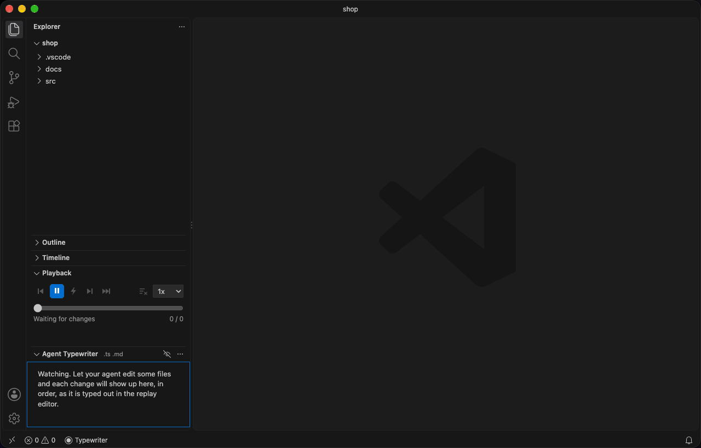

# Agent Typewriter


Watch Claude Code (or any agent, script, or teammate) write code as if a person were typing it.



Agent Typewriter ignores *how* a file was edited. It watches the workspace for changes on disk, records every change in order with its full before and after text, and replays each one into a side-by-side replay editor at human speed. When the agent touched three files, playback flips between those three tabs in the same order.

Your real files are never modified by the extension. Replay happens in mirror documents (`agent-typewriter:/src/foo.ts`) that get proper syntax highlighting from the file extension.

## Install

From the Visual Studio Code Marketplace: search for **Agent Typewriter** in the Extensions view, or run

```
code --install-extension burnzy1148.agent-typewriter
```

To try builds of the next release before it ships, click **Switch to Pre-Release Version** on the extension's page in VS Code. Pre-releases are tested builds of the `develop` branch, published from time to time. Switch back the same way.

To install a build from a [GitHub release](https://github.com/burnzy1148/agent-typewriter/releases) or a CI artifact instead, download the `.vsix` and run `code --install-extension agent-typewriter-<version>.vsix`, or use the Extensions view, `...` menu, **Install from VSIX...**.

## Use

1. Open your project folder.
2. Run **Agent Typewriter: Start Watching** (Command Palette, the status bar item, or the **Agent Typewriter** icon in the Activity Bar).
3. Let Claude Code work. The replay editor opens beside your current editor and starts typing.

Set `agentTypewriter.autoStart` to `true` to start watching whenever the workspace opens.

## Documentation

The full docs are at **[agent-typewriter.com](https://agent-typewriter.com)**:

- [How it works](https://agent-typewriter.com/docs/how-it-works/): snapshots, write order, the timeline buffer, renames, and how changes are planned as typing.
- [Highlights](https://agent-typewriter.com/docs/highlights/): git-diff-style marks for added and removed text, clearing them, and their colors.
- [The panels](https://agent-typewriter.com/docs/panels/): the Playback panel, the replay editor's controls, and the list of recorded changes.
- [Session files](https://agent-typewriter.com/docs/session-files/): save a run to a file and load it elsewhere.
- [Replaying git history](https://agent-typewriter.com/docs/git-history/): type out a branch, pull request or commit range.
- [Filters](https://agent-typewriter.com/docs/filtering/), the [repository settings file](https://agent-typewriter.com/docs/repository-settings/), [filter profiles](https://agent-typewriter.com/docs/filter-profiles/) and [worktrees](https://agent-typewriter.com/docs/worktrees/): choose which files are recorded.
- [Lanes](https://agent-typewriter.com/docs/lanes/): record several checkouts at once and choose which one replays.
- [Settings](https://agent-typewriter.com/docs/settings/): every setting and its default.
- [Limits](https://agent-typewriter.com/docs/limits/): what the extension does not do.

## Develop

```
npm install
npm test          # unit tests plus a fuzz test of the diff planner
npm run it        # integration tests in a real headless VS Code (needs xvfb on Linux)
npm run package   # typecheck, test, bundle, produce the .vsix
```

Run `npm run build` (or `npm run watch`), then press F5 with this folder open to launch an Extension Development Host.

## Contributing

Bug reports and pull requests are welcome, including fixes to the docs site in [`site/`](site/). See [CONTRIBUTING.md](CONTRIBUTING.md) for setup, tests, and how changes are proposed. Release notes are in [CHANGELOG.md](CHANGELOG.md).

## License

[MIT](LICENSE)
